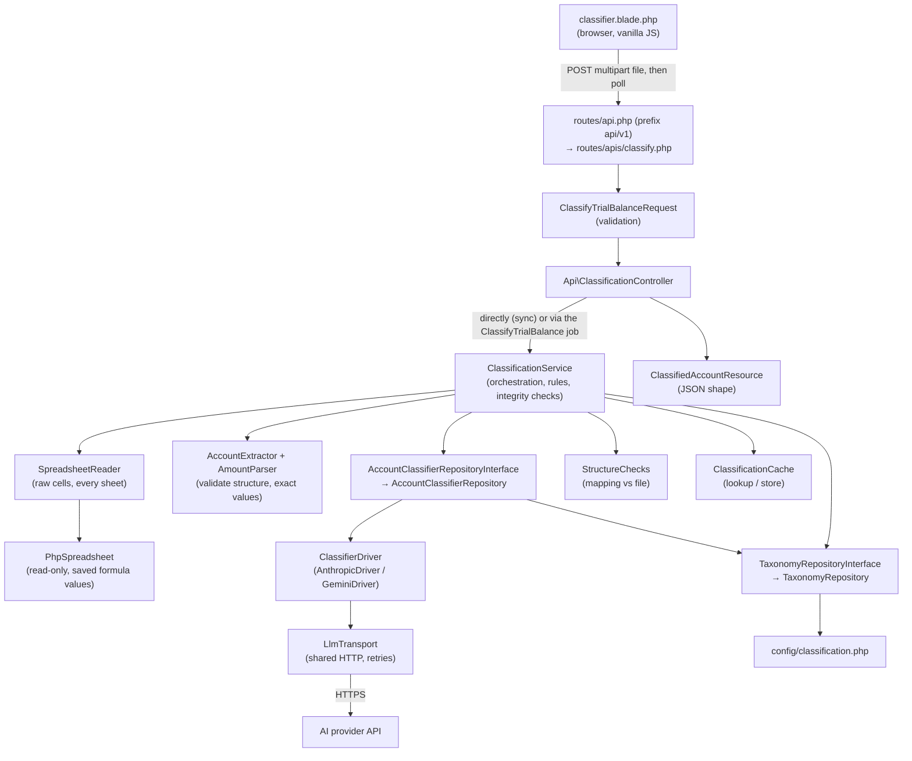

# 2. Architecture

## Style

A layered Laravel API with a **Controller → Service → Repository** structure and interface-based dependency injection.



## Layers

| Layer | Class | Responsibility |
|---|---|---|
| Routing | `routes/api.php`, `routes/apis/classify.php`, `routes/apis/classification-cache.php` | `api/v1` prefix (`bootstrap/app.php`); `/api/v1/classify/*` (sync, jobs, row correction) and `/api/v1/classification-cache/*` groups |
| Validation | `App\Http\Requests\ClassifyTrialBalanceRequest` | File required, type, size |
| Controller | `App\Http\Controllers\Api\ClassificationController` | Calls the service (sync) or queues `ClassifyTrialBalance` (jobs), maps exceptions to HTTP codes; `ClassificationResponse::make` builds `{data, meta}` |
| Service | `App\Services\ClassificationService` | Structure retry, cache lookup, batching + label retry, merging, rules, parent / number checks, confidence caps, file checks |
| Reader | `App\Services\SpreadsheetReader` | Every sheet → row → column letter → value; no interpretation |
| Extractor | `App\Services\AccountExtractor` | Normalizes/validates the AI structure; reads exact values per row |
| Amounts | `App\Services\AmountParser` | Number parsing (separators, Arabic-Indic digits, negatives, Dr/Cr) |
| Repository (AI) | `App\Repositories\Eloquents\AccountClassifierRepository` | Two forced-tool calls: `submit_structure`, `submit_rows`; prompts, schemas, missing-only retry, rolling pool. Each call goes through `App\Support\Llm\ClassifierDriver` |
| AI driver | `App\Support\Llm\{AnthropicDriver, GeminiDriver}` via `ClassifierDriver` | Everything provider-specific: wire format, schema conversion, retry delays and fatal errors, answers without a tool call, thinking level, warm-up. HTTP through `LlmTransport` |
| Repository (taxonomy) | `App\Repositories\Eloquents\TaxonomyRepository` | Lookup over the `taxonomy_*` tables (config list without them); former names; [16](16-taxonomy.md) |
| Resource | `App\Http\Resources\ClassifiedAccountResource` | Output field shape, adds `confidence_label` |

"Repository" here means a data-source abstraction: one source is an external AI API, the other is a config file. The `Eloquents` folder name is historical: the repositories use no Eloquent. The database is reached through six Eloquent models in `app/Models` (`ClassificationRun`, `ClassificationCacheEntry`, `ClassificationNameLayerEntry`, `ClassificationImport`, `ClassificationImportMapping`, `ClassificationImportRow`), used by the services, jobs and controllers.

## Dependency injection

Bindings in `app/Providers/AppServiceProvider.php`:

```php
AccountClassifierRepositoryInterface::class => AccountClassifierRepository::class
TaxonomyRepositoryInterface::class          => TaxonomyRepository::class   // scoped: once per request / queued job
TaxonomyMapperRepositoryInterface::class    => TaxonomyMapperRepository::class
Heartbeat::class                            // singleton
UsageMeter::class                           // singleton
LlmTransport::class                         // singleton
ClassifierDriver::class => match (CLASSIFIER_PROVIDER) { 'anthropic' => AnthropicDriver, 'gemini' => GeminiDriver }
                           // each gets its own config block; unknown → RuntimeException "Unknown CLASSIFIER_PROVIDER [x]. Use one of: anthropic, gemini."
```

`ClassificationService` depends on the interfaces plus `SpreadsheetReader`, `AccountExtractor`, `StructureChecks` and `ClassificationCache` (concrete, auto-resolved). `AccountClassifierRepository` depends on the **concrete** `TaxonomyRepository` (not the interface), `ClassifierDriver` and `UsageMeter`; `TaxonomyMapperRepository` on `ClassifierDriver` and `UsageMeter`. The `ClassifierDriver` binding is the only place that knows which provider runs; `App\Support\Llm\Provider::name()/model()` reads the configured provider and model for `meta` and the run / import records. The repository bindings are not singletons, so each resolution creates a new instance; `TaxonomyRepository` caches its map per instance. `Heartbeat`, `UsageMeter` and `LlmTransport` are shared per process, so the job, the repositories and the transport see the same heartbeat and token counts, and all requests share one Guzzle handler. `boot()` also refuses to start a queue worker whose `retry_after` is not above `ClassifyTrialBalance::TIMEOUT` (1800 s).

## Error handling

`bootstrap/app.php` registers two global renderers:

| Exception | Response |
|---|---|
| `NotFoundHttpException` | `404 {"status":"error","message":"Route not found"}` |
| `ValidationException`, `AuthenticationException`, `AuthorizationException`, any `HttpExceptionInterface` (405, 403, …), `HttpResponseException`, `ModelNotFoundException`, `TokenMismatchException` | Laravel default (e.g. `422 {"message", "errors"}`) |
| Any other `Throwable` | `500 {"status":"error","message":<exception message>}` |

`shouldRenderJsonWhen` forces JSON for every `api/*` request, even without `Accept: application/json`.

The sync endpoint (`ClassificationController::classify`) catches these itself:
- `StructureNotDetected` → `422 {message, problems, structure}` (`message` = `ما قدرناش نقرا أعمدة الميزان صح:` + one line per problem);
- any other `RuntimeException` → `422 {message}`;
- `App\Support\Llm\ProviderException` (message for the user + `fatal` flag) → `report()` + `502 {message}`: for a fatal error the driver's own message (e.g. `Anthropic API credit balance is too low. Add credits, then retry.`, `Gemini API key is missing. Set GEMINI_API_KEY in .env, then run php artisan queue:restart.`) or `AI provider rejected the request: …`; otherwise `AI provider error, please retry.`.

The queued job catches the same exceptions and stores the message in the run's `error`.

## Persistence

SQLite (`database/database.sqlite`): `classification_runs` (queued runs and their results), `classification_cache` and `classification_name_layer` (the cache), `classification_imports`, `classification_import_mappings`, `classification_import_rows` (accountant imports). Diagram and the role of each table: [13-database-schema.md](13-database-schema.md). Laravel defaults alongside: `users`, `password_reset_tokens`, `sessions`, `cache`, `jobs`, `failed_jobs`, `personal_access_tokens` (Sanctum, installed but unused).

## Directory map

```
Accounting-System/
└── accounting-import/            # ← the Laravel app
    ├── app/
    │   ├── Http/
    │   │   ├── Controllers/Api/ClassificationController.php
    │   │   ├── Controllers/Api/ClassificationCacheController.php     # cache explain/entries, row correction
    │   │   ├── Controllers/Api/ClassificationImportController.php    # accountant imports
    │   │   ├── Controllers/Api/ClassificationTransferController.php  # export / import of the cache
    │   │   ├── Requests/ClassifyTrialBalanceRequest.php
    │   │   └── Resources/ClassifiedAccountResource.php
    │   ├── Console/Commands/                   # classification:prune, check-structure, demo-confirmation, import, cache-cleanup; classifier:probe, classifier:compare
    │   ├── Exceptions/                         # StructureNotDetected, LeaseLost
    │   ├── Models/                             # the 6 classification models; User.php (default, unused)
    │   ├── Providers/AppServiceProvider.php    # bindings, queue-worker safety check
    │   ├── Repositories/
    │   │   ├── Contracts/                      # interfaces
    │   │   └── Eloquents/                      # implementations
    │   ├── Jobs/                               # ClassifyTrialBalance, ProcessClassificationImport
    │   ├── Services/
    │   │   ├── ClassificationService.php
    │   │   ├── ClassificationCache.php         # cache lookup/store, side pairs
    │   │   ├── CacheImport.php                 # accountant imports
    │   │   ├── CacheTransfer.php               # export / import
    │   │   ├── CacheCleanup.php                # one-time cache cleanup
    │   │   ├── StructureChecks.php
    │   │   ├── SpreadsheetReader.php
    │   │   ├── AccountExtractor.php
    │   │   └── AmountParser.php
    │   └── Support/                            # ClassificationKey, ClassificationResponse, ImportNormalizer, Heartbeat, Llm/ (ClassifierDriver, AnthropicDriver, GeminiDriver, LlmTransport, ToolCall, ToolAnswer, ProviderException, Provider, UsageMeter, LlmCost)
    ├── bootstrap/app.php                       # routing (apiPrefix api/v1) + global exception renderers
    ├── config/classification.php               # taxonomy + AI + rule config
    ├── database/                               # migrations/ (Laravel defaults + classification tables), database.sqlite
    ├── resources/views/                        # classifier, classification-cache, classification-import-review
    ├── routes/
    │   ├── api.php                             # prefix classify → apis/classify.php, classification-cache → apis/classification-cache.php
    │   ├── apis/classify.php                   # POST /trial-balance, jobs, row correction
    │   ├── apis/classification-cache.php       # cache, imports, export / import
    │   └── web.php                             # /, /classifier, /classification-cache, review page, /api/docs (Swagger UI)
    ├── tests/
    │   ├── Feature/                            # HTTP-level: flow, errors, page
    │   ├── Unit/                               # amounts, reader, extractor, structure checks, taxonomy, cache key, concurrency config
    │   └── Support/                            # TrialBalanceFiles (xlsx/csv builders + AI fake), FakeWire, FakeAi, RecordingClassifier, FakeTaxonomyMapper, BalanceXlsxExpectations
    └── docs/                                   # this documentation
```
