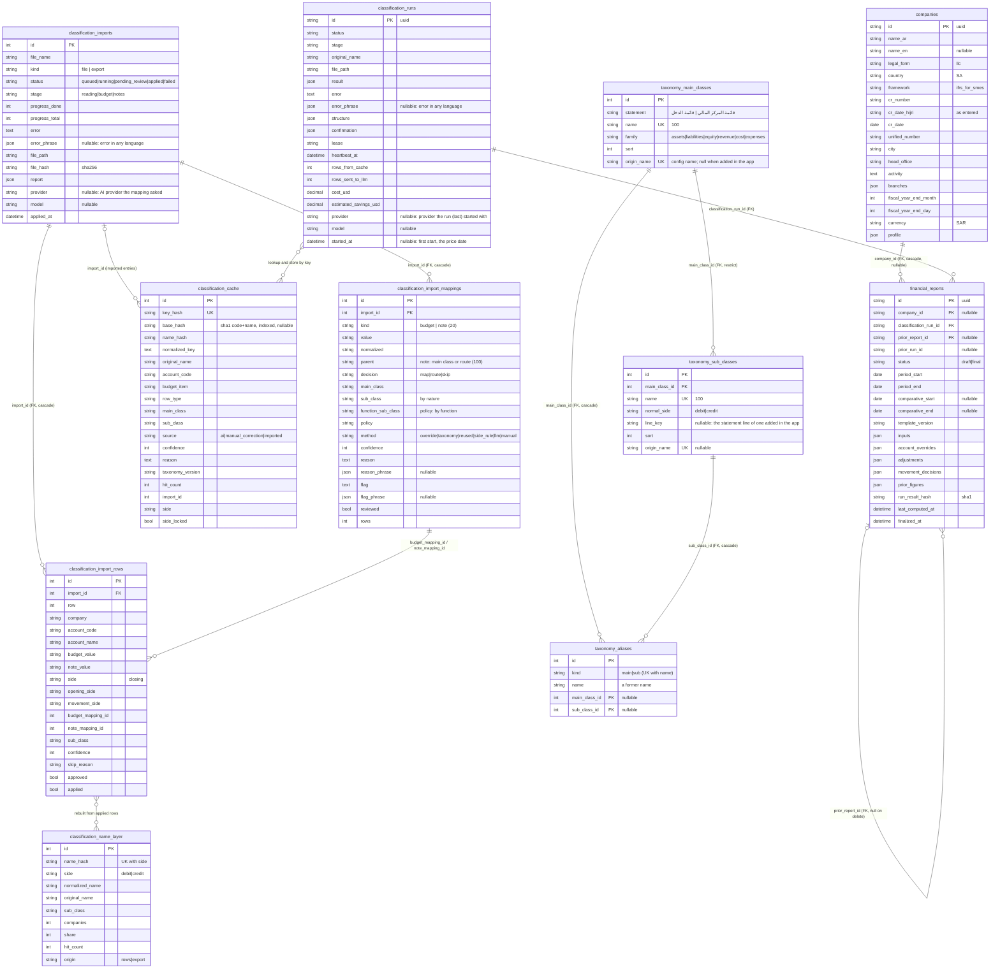

# 13. Database schema

SQLite (`database/database.sqlite`). Application tables for classification, the financial statements, access, and the taxonomy (`taxonomy_main_classes`, `taxonomy_sub_classes`, `taxonomy_aliases`, [16](16-taxonomy.md)). Other tables store main and sub-classes by name (no foreign key): a rename on the taxonomy page updates the memory and import tables and records the old name as an alias; classification runs keep their names.

## Tables

| Table | Role | Why it matters |
|---|---|---|
| `classification_runs` | One trial balance being classified: job state, detected structure and the user's confirmation, the full result, tokens and cost | The page polls it. `lease` / `heartbeat_at` stop two workers processing the same run. Each result row carries its `cache_key`. `provider` / `model` (set on every start, so a resumed run shows those it resumed with) and `started_at` (first start only: the day `cost_usd` is priced at) come from migration `2026_10_08_000001`; all nullable, `null` for older runs |
| `classification_cache` | The classifier's memory: one entry per account key ([11](11-classification-cache.md)) | Every run reads it first, so a known account costs no AI call. Priority manual > ai > imported is enforced on write. Side-pair sub-classes are stored as their base class. `base_hash` (sha1 of `code:…\|name:…`, string 40, nullable, indexed; migration `2026_10_06_000001`, filled by every writer) finds imported entries by code + name when a client row has no budget item |
| `classification_name_layer` | Answers by account name and balance side when the key misses | Codes differ per company, so a new company rarely matches by key. Only names most companies agree on (≥ 2 companies, ≥ 80%) |
| `classification_imports` | One uploaded accountant file, or one imported JSON export (`kind`) | Job status and progress for the page, the report, and the hash behind the duplicate warning. `provider` / `model` (nullable, migration `2026_10_08_000001`): set at the import's first AI call; `null` when no value needed the AI |
| *(phrases)* | `classification_runs.error_phrase`, `classification_imports.error_phrase`, `classification_import_mappings.reason_phrase` / `flag_phrase` (migration `2026_10_18_000003`) | The stored Arabic message as a phrase (lang key + params, `App\Support\Phrase`), so the API gives it in the reader's language (`*_text`). `null`: an older record, or text that is data (an AI's reason, a config text) |
| `classification_import_mappings` | One decision per distinct value: الميزانية → main class, (main class, الإيضاحات) → sub-class | Where the accountant reviews: about 5,000 rows become about 1,000 decisions. Approved mappings are reused by later uploads. Unique on (`import_id`, `kind`, `parent`, `normalized`), index `cim_import_kind_parent_normalized_unique` (explicit short name and `kind` 20 / `parent` 100 characters, for MySQL's identifier and key-length limits) |
| `classification_import_rows` | Every line of the file, with its mappings and resolved sub-class | Traceability and skip reasons. Only rows whose mappings are all approved (`approved`) reach the cache |
| `companies` | A company profile for the financial statements ([14](14-financial-statements.md)), reused across years | `cr_date_hijri` is text, stored as entered. `branches` and `profile` are JSON in `text` columns. No owner column yet (local-only). Migration `2026_10_13_000001` |
| `taxonomy_main_classes`, `taxonomy_sub_classes`, `taxonomy_aliases` | The taxonomy, edited at `/taxonomy`, seeded from config by migration `2026_10_18_000004` ([16](16-taxonomy.md)) | The AI's allowed list, the families and normal sides the checks use, the line of a sub class added in the app. Aliases (every former name) let old runs build statements; a name is unique per kind among current and former names |
| `financial_reports` | One set of statements built from a finished run | `run_result_hash` (sha1 of the run's `result` at the last compute) gives `run_changed` when a row is corrected later. `inputs`, `account_overrides`, `adjustments`, `prior_figures` are JSON, filled by later steps. Same migration; `movement_decisions` (JSON, the decisions on the movement suggestions) from `2026_10_14_000001` |

## Relations

| From → to | Type | Why it matters |
|---|---|---|
| imports → import_mappings | Foreign key, cascade delete | Each decision belongs to one import; deleting an import removes them. Later imports search all mappings to reuse decisions |
| imports → import_rows | Foreign key, cascade delete | Keeps every source line with its import for the report and the review page |
| import_rows → import_mappings | `budget_mapping_id`, `note_mapping_id` (no constraint) | Changing one mapping re-resolves every row that uses it: one review click fixes hundreds of rows |
| imports → classification_cache | `import_id`, set on `imported` entries only (no constraint) | A repeated «تطبيق» removes only the entries that import wrote and no longer produces. AI and manual entries are never touched |
| import_rows → classification_name_layer | Derived, no column | Rebuilt from `applied` rows of every import; it can be recomputed whenever the thresholds change |
| classification_runs ↔ classification_cache | By key hash, no column | A run looks entries up and stores good AI answers. A row correction uses the row's `cache_key` to save a manual entry |
| companies → financial_reports | Foreign key, nullable, cascade delete | A report may have no company; deleting a company removes its reports |
| classification_runs → financial_reports | Foreign key (no cascade) | A report reads its run every time; runs are never deleted (only their files) |
| financial_reports → financial_reports | `prior_report_id`, foreign key, null on delete | The prior year's report, for the comparatives (a later step) |

Laravel's own tables (`users`, `sessions`, `password_reset_tokens`, `personal_access_tokens`, `cache`, `cache_locks`, `jobs`, `job_batches`, `failed_jobs`, `migrations`) hold no classification data. `jobs` carries the queued classification runs and imports.
