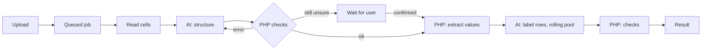

# Architecture summary

## What the system does

A web app that takes a trial balance (ميزان المراجعة) as Excel or CSV, in any layout, and classifies every account into a fixed chart of financial-statement categories. Each account gets a confidence score and a short reason. The system also runs numeric checks and flags rows for review. It is a Laravel (PHP) application that calls an AI provider's API (Claude by default; a Gemini driver exists, not yet run against the real API).

## How it works

1. **Upload.** The file is stored and a background job is queued. The page polls for progress. A synchronous endpoint also exists for small files.
2. **Read.** PHP reads every cell of every sheet.
3. **Structure detection (AI).** From a preview of the sheets, the AI says which sheet and rows hold the trial balance, and which column holds each field.
4. **Structure checks (PHP).** The mapping is checked against the file itself. Clear errors go back to the AI for one retry. If problems remain, a queued run waits for the user to confirm or correct the mapping. The synchronous endpoint returns the problems instead.
5. **Extraction (PHP).** Exact values are read from the cells.
6. **Labelling (AI).** Rows the classification cache already knows are labelled from the database. The rest are sent in batches through a rolling pool with a limit on concurrent requests. With Anthropic, a first minimal call warms a shared prompt cache. A separate call matches adjustment lines and the file's own classification column, when the file has them.
7. **Checks (PHP).** Balance formulas, abnormal balances, totals, duplicates, parent accounts and account numbers against the file's own numbering are checked. The file's classification is compared with the AI's. Abnormal balances and number mismatches cap the confidence.
8. **Result.** The result is stored as JSON and the uploaded file is deleted.

## What the AI decides vs what PHP owns

The AI decides only the structure (which column is what) and the labels (row type, category, confidence, reason). Every answer is forced into a fixed schema with allowed values, then validated again in PHP.

PHP owns all numbers, all calculations and all checks. The AI never produces an amount.

## How mistakes are caught

- **Structure checks** test the AI's mapping against the file. They look at:
  - header text that contradicts the field
  - one column mapped to two fields
  - value types, such as names that are numbers or amounts that are text
  - rows that would be skipped
  - whether closing = opening + movement. When that fails, the system tests likely swaps and names the one that fixes the rows.

  Each finding is an **error** (certainly wrong) or a **doubt** (suspicious).
- **The confirmation step** pauses a queued run when errors remain after the retry, or on doubts that can make results wrong. The user sees each column's header and sample values and fixes the mapping. New doubts caused by the user's own edit need an explicit "confirm anyway". Other doubts appear as warnings with the result.
- **Retries.** Timeouts, rate limits and server errors get up to two retries, honouring the provider's wait time. Missing rows in an answer are asked for again, and only those rows. Errors like no credit or an invalid key stop the run.
- **Partial results.** If some rows still come back unclassified, the run is marked partial. The page shows a separate red banner with the count and row ranges. If every batch fails, the run fails.

## Reliability and data

- **One worker per run.** A worker takes a run by setting a random lease in one conditional update. Every later write requires that lease, so a second worker, or a stale one, can't overwrite the run or delete its file. A worker refuses to start if the queue could hand a running job to another worker too early.
- **Crashes.** The running worker refreshes a heartbeat throughout, including during long AI calls and waits. A run whose heartbeat is stale for 10 minutes is marked failed by a check that runs every 5 minutes. A whole file is never re-run automatically.
- **Files.** The upload is deleted as soon as a run ends. A run waiting for confirmation keeps its file and a column preview for up to 24 hours. Cancelling deletes them at once. An hourly cleanup removes expired and orphaned files, but only if the scheduler is running. Logs record structure-check measurements, not cell values.

## Performance

Measured on the same 16-batch file (about 780 rows), 4 requests in flight:

| Run (30 Sep 2026) | Model | Time end to end | Notes |
|---|---|---|---|
| Scripted measurement run | Claude Haiku 4.5 (`claude-haiku-4-5`) | 98 s | Before the dedicated matching call was added. The token profile below comes from this run. The run log didn't record the model: it is the one `.env` was set to at the time. |
| Latest run through the app | Claude Sonnet 5 (`claude-sonnet-5`) | 104 s | Includes the matching call. |

Every result now records the provider, the model and the tokens used (`meta.provider`, `meta.model`, `meta.usage`), and so does the run's `classification_summary` log line, so cost and quality can be compared per model from the output itself.

## Model options

Prices are per million tokens (input / cached input / output), taken from each provider's official pricing page on 30 September 2026. Standard tier and global routing. A research snapshot: the app now supports only Anthropic and Gemini (`CLASSIFIER_PROVIDER`); the OpenAI rows are for comparison only.

Cost per file uses the token profile measured on the 16-batch file with Claude Haiku 4.5 (about 780 rows, 20 calls, before the dedicated matching call was added):
- 119,176 uncached input tokens
- 36,665 cache-write tokens
- 659,970 cached-read tokens
- 43,662 output tokens

Anthropic charges cache writes at 1.25× input. Google and OpenAI have no write premium, so the first pass is counted as normal input. The estimates assume every model produces the same number of tokens, and exclude thinking/reasoning tokens.

| Model | Input ($/1M) | Cached input ($/1M) | Cache write ($/1M) | Output ($/1M) | Est. cost per file | Expected quality for our task (not measured) |
|---|---|---|---|---|---|---|
| Claude Haiku 4.5 (default) | $1.00 | $0.10 | $1.25 | $5.00 | ≈ $0.45 | Runs our full pipeline reliably. Structured output holds; 2 of 16 batches needed a missing-rows retry. Classification accuracy not benchmarked. |
| Claude Sonnet 5 | $2.00 | $0.20 | $2.50 | $10.00 | ≈ $0.90 | Run once on the 16-batch file: amounts identical, better labels on the ambiguous accounts; still put one expense account (end-of-service) on the balance sheet. |
| Claude Opus 5 | $5.00 | $0.50 | $6.25 | $25.00 | ≈ $2.25 | Not run yet. Expected best on the accounting rules. |
| Gemini 2.5 Flash-Lite | $0.10 | $0.01 | — | $0.40 | ≈ $0.04 | Expected weakest: small, older model; risk on nuanced Arabic accounting terms and on following our long rule set. |
| Gemini 3.1 Flash-Lite | $0.25 | $0.025 | — | $1.50 | ≈ $0.12 | Expected better than 2.5 Flash-Lite, still a lite-tier model. |
| Gemini 3 Flash (Preview) | $0.50 | $0.05 | — | $3.00 | ≈ $0.24 | Expected in Haiku's range or better. Preview: behaviour and price may change. |
| GPT-5.4-nano | $0.20 | $0.02 | — | $1.25 | ≈ $0.10 | Expected weakest of the OpenAI pair; reasoning tokens add cost. |
| GPT-5.4-mini | $0.75 | $0.075 | — | $4.50 | ≈ $0.36 | Expected roughly comparable to Haiku; reasoning tokens add cost. |

- **Only Claude Haiku 4.5 and Claude Sonnet 5 have been run through our system.** Quality for every other model is unverified until the real files are classified with it and compared.
- **Claude Sonnet 5.5, Opus 5.5 and Fable 5.1 don't work with the code as it is:** they reject the forced tool call both AI steps use (HTTP 400). Using them needs a code change (tool choice `auto` with a strict schema).
- **The app's own cost figures** (`cost_usd` per run) use `config('classification.prices')`, not this table. It has `claude-haiku-4-5`, `claude-sonnet-5`, `claude-sonnet-5-5` and `claude-opus-5-5` (Anthropic pricing page, checked 2 October 2026; Opus 5.5 there: $4.00 input, $5.00 cache write, $0.20 cached, $20.00 output). It also has `gemini-3.8-flash` (not in this table; Google pricing page, paid tier, checked 8 October 2026: $0.75 input / $0.075 cached / $3.75 output until 31 December 2026, then $1.50 / $0.15 / $7.50; no cache-write price). Prices carry a start date and a run is priced at the one in effect when it first started. `claude-opus-5` and the other models above have no entry, so their runs report `cost_usd: null`.
- **The structure checks catch wrong column mappings, not wrong classifications.** A cheaper model's classification mistakes would only be caught by the reviewer, helped by the confidence score and the comparison with the file's own classification.
- **Thinking and reasoning tokens are billed as output** on the Gemini and OpenAI models above. That can raise the real cost well above these estimates unless reasoning is kept low (the Gemini driver sends `thinkingLevel` `low` by default, `CLASSIFIER_GEMINI_THINKING_LEVEL`).
- **Switching provider is one variable** (`CLASSIFIER_PROVIDER`: `anthropic` | `gemini`; each provider keeps its own key and model), then `php artisan queue:restart`. **Gemini has not been run against the real API yet** (no key yet): it is covered only by faked tests. Run `php artisan classifier:probe --provider=gemini` and `classifier:compare` on a real file before relying on it.

## Current setup and limitations

- **Single node.** SQLite, a database-backed queue and local file storage. Fine for one worker. Several workers need MySQL/PostgreSQL or Redis for the queue.
- **Concurrency is per worker.** Each worker limits its own AI requests, but there is no global limit across workers against the provider's rate limit.
- **No authentication.** Anyone with a run's ID can read it, confirm it or cancel it.
- **Account data is sent to the configured AI provider** (Anthropic by default) for structure detection and classification.
- **Checks were calibrated on 5 real files** (one writes zeros as "-") and 8 synthetic layouts, with `classification:check-structure --calibrate`. On a mapping the user confirmed, only errors that break the extraction block; measurement errors need an explicit "confirm anyway", and an overridden swap is shown as ⛔. They show no false alarms there, but real-world tuning depends on more files and the logs. Two swaps can't be seen from the numbers:
  - opening ↔ movement, which only the headers can reveal
  - a debit/credit swap across every group under generic headers, which only raises a warning after classification (not yet calibrated on real AI output)
- **Not yet run end to end with real AI calls:** the matching call, the confirmation step, the lease and heartbeat, and partial results. They are covered by automated tests, and the confirmation step by local demo runs, but API credit ran out before a full live run.
- **To scale:**
  - a server database and Redis queue
  - shared file storage
  - a shared rate limiter for AI calls
  - user accounts with per-run ownership
